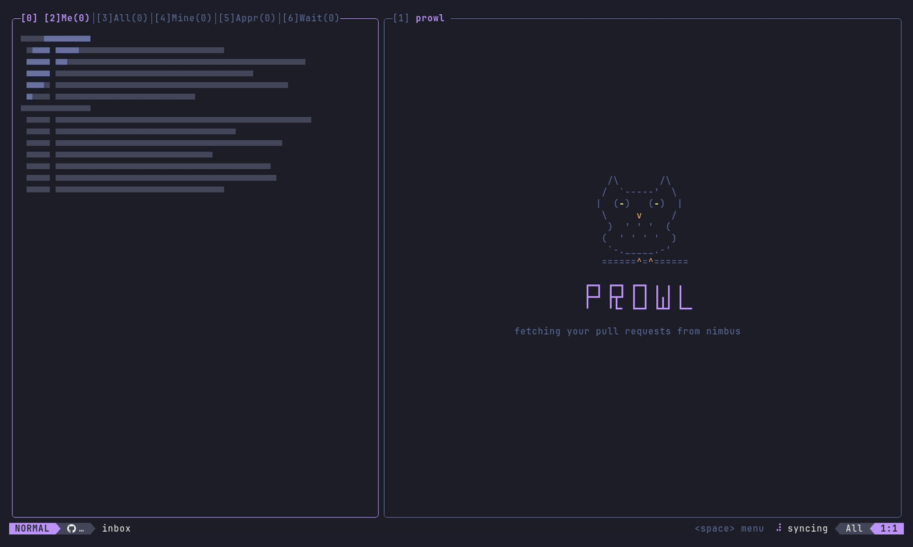
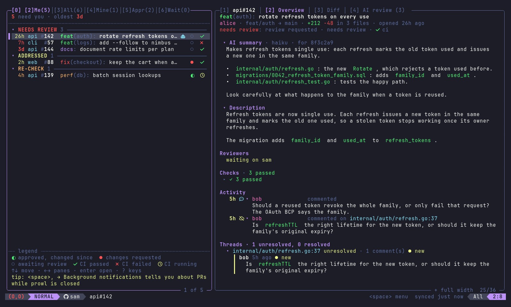
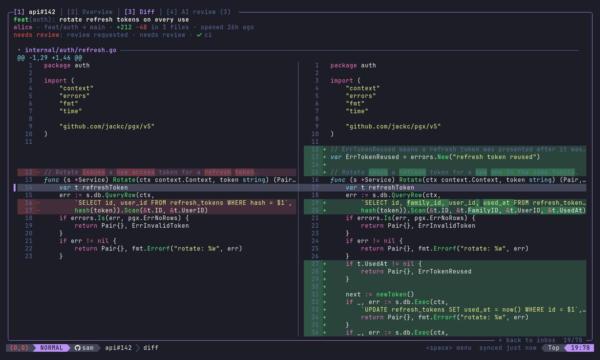
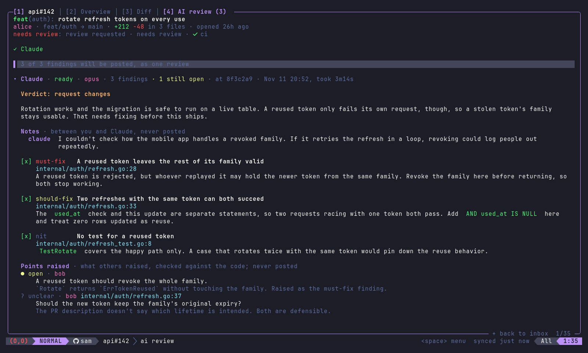

# prowl

```
   /\       /\
  /  `-----'  \
 |  (O)   (O)  |
  \     v     /
   )  ' ' '  (
  (  ' ' ' '  )
   `-._____.-'
  ======^=^======
```

**The PR owl.** prowl keeps watch over your GitHub pull requests from the terminal. It shows which ones are waiting on you and why, lets you read, review and approve without leaving the keyboard, and brings a coding agent along to review with you. When nothing needs you, the owl goes to sleep.

It runs in the terminal today. The engine underneath is separate from the interface, and a VS Code extension is next.



## What it does

- **Sorts by what you owe.** Every open PR that involves you lands in one place, ordered by what it needs from you: a first review, a re-review, a look at what the author changed after you asked, a re-approval. The ones that waited longest come first.
- **Reads like GitHub, minus the browser.** The conversation newest first, review threads, CI checks with the reason a check failed, and a syntax-highlighted diff, unified or side by side.
- **Reviews with you.** Claude Code or Codex reviews the PR in a throwaway checkout, checks what other reviewers and bots already raised, and drafts replies to your threads. You edit the review in your own editor, and nothing reaches GitHub until you save it.
- **Reviews your branch before the PR.** `prowl review` reviews the work in your checkout, committed or not, and a coding agent can call it on itself before it says it's done.
- **Keeps watch when you're not looking.** `prowl watch` sends a desktop notification when something needs you, and catches you up on what happened while it wasn't running.
- **Keyboard first, mouse friendly.** Vim motions and a which-key leader menu, but the arrow keys, `?` for help and the mouse work just as well.

## Quick start

Install it:

```sh
# Linux and macOS
curl -fsSL https://raw.githubusercontent.com/tmstorm/prowl/main/install.sh | sh
```

```powershell
# Windows
irm https://raw.githubusercontent.com/tmstorm/prowl/main/install.ps1 | iex
```

Or with Go: `go install github.com/tmstorm/prowl@latest`.

Then log in to GitHub with the [GitHub CLI](https://cli.github.com) if you haven't (prowl uses its credentials) and start it:

```sh
gh auth login
prowl
```

That's it. Actions live behind the leader key: `space` by default, and `,`, `\` or `;` if you'd rather (set `leader` in the config or the options). The docs write it `<leader>`, so `<leader>a` means the leader, then `a`. Not a vim user? The arrow keys move around, `?` lists every key, and the `menu` button at the bottom right opens every action with a click.

A few things worth doing next:

- Set `orgs` to your organizations so the inbox shows your work rather than all of GitHub. `<leader>,` opens the options.
- Install [Claude Code](https://claude.com/claude-code) or the [Codex CLI](https://github.com/openai/codex) for AI reviews.
- Turn on background notifications (`<leader>,` → Background notifications, or `prowl service install`) to hear about PRs while prowl is closed.

## A short tour

**The inbox** is split into what needs you, everything, your own PRs, approved and waiting. Each row says how long the PR has waited on you, its size, review state and CI. The owl at the bottom left reads the room: `(-,-)` nothing needs you, `(o,o)` something does, `(O,O)` something is overdue. See [the inbox](docs/inbox.md).



**A PR** opens in the right pane: an AI summary if you want one, the description, where each reviewer stands, the CI checks, the activity newest first, and the open threads. `+` gives it the whole width. Comment on a line with `c` or suggest a change with `S`, approve with `<leader>a`, request changes with `<leader>x`. `<leader>n` leaves a plain comment in the conversation and `<leader>A` asks someone for a review, or for another look. See [reading and reviewing](docs/reviewing.md).



**AI reviews** start with `<leader>cc`. The owl keeps an eye on the agent while it reads the PR and its repo's guidelines, then verifies its own findings before you see them. You get findings to include or leave out, the points others raised checked against the code, and draft replies to threads where someone answered you. `<leader>p` turns it all into one review in your editor. When a PR shouldn't go in as it is, the agent says so too, and the same editor can close it or make it a draft. See [AI reviews](docs/ai-reviews.md).



**Before a pull request**, `prowl review` in your checkout reviews the branch the same way and prints the findings. It exits with status 2 on a must-fix finding, so a Claude Code hook can keep an agent working until its review is clean. See [reviewing before a pull request](docs/ai-reviews.md#reviewing-before-a-pull-request).

## Docs

- [Installing](docs/install.md): every install path, what prowl needs, commands, background notifications, updates, logins
- [The inbox](docs/inbox.md): how PRs are sorted, watching a repo, focusing
- [Reading and reviewing](docs/reviewing.md): keys, the diff, comments and suggestions, approving, asking for reviews
- [AI reviews](docs/ai-reviews.md): agents, models, profiles, severities, replies, closing or drafting, local reviews, hooks
- [Config](docs/config.md): every setting and its default

`?` in prowl lists every key.

## Where it's going

prowl is pre-1.0: the `0.x` releases may still change how things work. The engine (`internal/core`) has no terminal code in it, so other interfaces can sit on top. The roadmap:

- **A stable core, then 1.0.** Settle the engine's API so other interfaces can rely on it.
- **A VS Code extension**, built on that core, for reviewing without leaving the editor.
- **Re-review on push.** An option to start a re-review when an author pushes after your review, so it's ready before you open the PR.
- **Any model for summaries.** An OpenAI-compatible endpoint setting (OpenAI, Anthropic, xAI, or your own Ollama or llama.cpp server), so summaries work without Claude Code or Codex.
- **Slack.** A PR link shared in your channels lands in the inbox like a review request, and the status line posts to the thread instead of going through your clipboard.
- **Packages:** AUR (`prowl-bin`) first, then Homebrew and Scoop, so installing is one package-manager command on every system.

Being considered: merging from prowl. For now prowl stays review-only, and merging happens on GitHub where the repo's merge rules live.

## Contributing

`go build` builds it and `go test ./...` runs the tests; the [Taskfile](Taskfile.yml) has the same as `task build` and `task test`. Commits follow [Conventional Commits](https://www.conventionalcommits.org), which release-please turns into releases and the changelog. See [CONTRIBUTING.md](CONTRIBUTING.md) for the rest. Pull requests are reviewed with prowl, naturally.

## License

[MIT](LICENSE)
